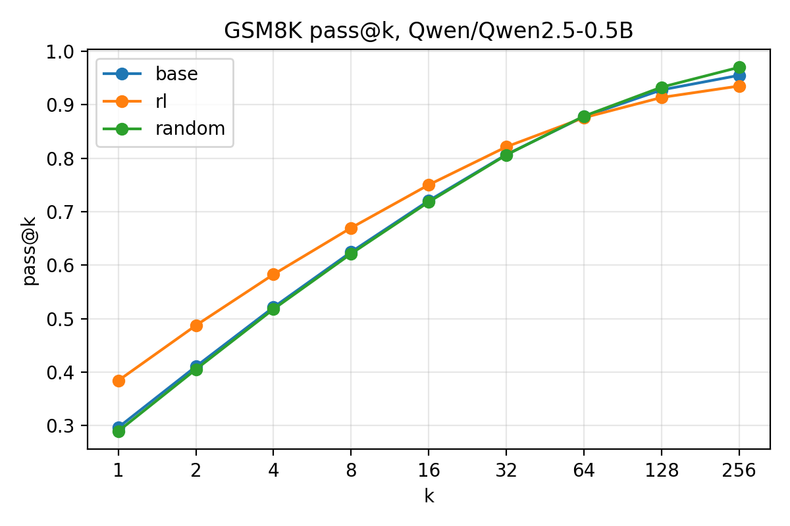

# Does RL teach new skills, or only sharpen?

A small-scale reproduction of **Yue et al. (2025), "Does Reinforcement Learning Really Incentivize Reasoning Capacity in LLMs Beyond the Base Model?"**, run on a free GPU, with a random-reward control the original paper does not use.

**Result: on Qwen2.5-0.5B and GSM8K, RL with a correctness reward behaves like sharpening.** It raises pass@1 by 8.7 points, but the base model catches up by k = 64 and finishes ahead at k = 256. RL's outputs are *more* likely under the base model than the base model's own samples. The few problems that only the RL model solves are no more than the random-reward control also "solves" by chance.



## Setup

| | |
|---|---|
| Model | `Qwen/Qwen2.5-0.5B` (base, not Instruct) |
| Task | GSM8K, 200 test problems (fixed shuffle, seed 0), 2-shot prompt |
| Training | GRPO with a LoRA adapter (rank 32), 300 steps, group size 8, no KL penalty (Unsloth + TRL) |
| Sampling | 256 samples per problem, temperature 0.6, top-p 0.95 (vLLM) |
| Grading | Strict: only `#### N` or `\boxed{N}` counts, with no last-number fallback, so random numbers can't pass at large k |
| pass@k | Unbiased estimator from Chen et al. (2021), k = 1 to 256 |

Three models get the identical prompt and sampling settings:

1. **base**: the untouched model
2. **rl**: GRPO with a binary correctness reward
3. **random**: GRPO with a coin-flip reward that pays 1 with probability 0.5 regardless of the answer. If this also improved results, part of the "RL gain" would be format or contamination rather than learning from the task.

## Results

### pass@k

| k | 1 | 2 | 4 | 8 | 16 | 32 | 64 | 128 | 256 |
|---|---|---|---|---|---|---|---|---|---|
| base | 0.297 | 0.411 | 0.521 | 0.625 | 0.721 | 0.807 | **0.878** | **0.928** | 0.955 |
| rl | **0.384** | **0.487** | **0.583** | **0.670** | **0.750** | **0.821** | 0.876 | 0.914 | 0.935 |
| random | 0.290 | 0.405 | 0.518 | 0.621 | 0.718 | 0.806 | 0.879 | 0.933 | **0.970** |

RL leads through k = 32. The curves cross between k = 32 and 64, and the base model is ahead from there on. This is the pattern Yue et al. report at much larger scale.

The random-reward control tracks the base model at every k. **The pass@1 gain comes from the correctness signal, not from format or from GRPO itself.** Format accounts for little of it: the share of samples with an extractable answer went from 96.2% (base) to 99.0% (rl), and the random control was 93.6%.

### Which problems does each model solve? (any of 256 samples)

| | Solved by both | Only this model | Lost (base solved it, this model didn't) | Neither |
|---|---|---|---|---|
| rl vs base | 184 | 3 | 7 | 6 |
| random vs base | 190 | 4 | 1 | 5 |

**RL's 3 "new" problems are not evidence of a new skill.** The random-reward control, which learned nothing about the task, picked up 4 such problems. A problem the base model missed in 256 samples isn't impossible for it, just rare, so a second draw of 256 from a nearly identical model solves a few by chance. RL also *lost* 7 problems the base model could solve, against 1 for the control. That's the narrowing you'd expect from sharpening.

### By how often the base model solves each problem

| Base solve rate | n | base pass@1 | rl pass@1 | random pass@1 | base pass@256 | rl pass@256 | random pass@256 |
|---|---|---|---|---|---|---|---|
| never (0%) | 9 | 0.000 | 0.003 | 0.003 | 0.00 | 0.33 | 0.44 |
| rare (<5%) | 53 | 0.022 | 0.053 | 0.022 | **1.00** | 0.87 | 0.98 |
| sometimes (5–50%) | 85 | 0.214 | 0.336 | 0.212 | 1.00 | 1.00 | 1.00 |
| often (≥50%) | 53 | 0.754 | 0.857 | 0.729 | 1.00 | 1.00 | 1.00 |

RL raises pass@1 in every bucket the base model can already solve. Its coverage loss is concentrated in the "rare" bucket: the base model solves all 53 of these problems at k = 256, and RL solves 87% of them. On the 9 "never" problems, RL does no better than the random control.

### Perplexity of each model's outputs under the base model

| Outputs from | Median perplexity | Mean |
|---|---|---|
| base | 1.403 | 1.426 |
| rl | **1.312** | **1.334** |
| random | 1.396 | 1.406 |

RL's outputs are *less* surprising to the base model than the base model's own samples. RL is concentrating on reasoning paths the base model already preferred, which is Yue et al.'s second piece of evidence for sharpening.

## What this does and doesn't show

At this scale, every measurement points to sharpening: RL makes the model more reliable on problems it could already solve, and gives up some rare successes to do it. It doesn't show RL can *never* teach new skills. The limits:

- **Small model, easy task, short training.** 0.5B parameters, GSM8K, 300 LoRA steps. Longer or full-parameter training, or harder tasks, may behave differently. Recent work argues that prolonged RL can expand the base model's coverage.
- **200 problems, one seed, no confidence intervals.** The crossover point and the bucket numbers would move with another seed. The overlap counts (3 vs 4, 7 vs 1) are small.
- **Possible contamination.** GSM8K may appear in Qwen2.5's pretraining data. The random-reward control is a partial check: it gave no pass@1 gain, so the gain isn't contamination unlocked by GRPO alone.
- **Unverified "new" solutions.** I haven't hand-checked whether RL's correct answers on problems 12, 50 and 78 come from valid reasoning or lucky numbers. Cell 15 of the notebook prints them.

## Next

**Step 2:** rerun with `Qwen/Qwen2.5-0.5B-Instruct` as the starting point and compare the bucket tables, to see whether post-trained models behave differently under further RL. Also planned: more seeds with bootstrapped intervals, longer training, and a KL-penalty ablation (`beta = 0.04`).

## Reproduce

Open `rl_sharpening_step1.ipynb` in Colab with a T4 GPU, or a Kaggle GPU notebook, and run the stages in order. Each stage saves to Google Drive (or `/kaggle/working`) and skips finished work, so a disconnect loses nothing. Restart the runtime between GPU stages. Rough cost on a T4: about 45 minutes for base sampling, 1.5 to 2.5 hours per GRPO run, and about 45 minutes to sample each trained model.

```
rl_sharpening_step1.ipynb   full pipeline: sampling, GRPO, analysis, perplexity
results/results.json        every number in this README
results/pass_at_k.png       the plot above
```

## Reference

Yue, Y., Chen, Z., Lu, R., Zhao, A., Wang, Z., Yue, Y., Song, S., & Huang, G. (2025). *Does Reinforcement Learning Really Incentivize Reasoning Capacity in LLMs Beyond the Base Model?* NeurIPS 2025. arXiv:2504.13837.
